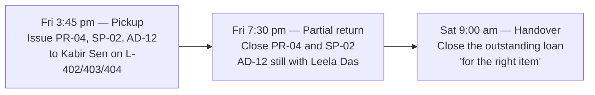
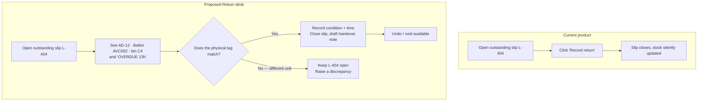

# Campus Stores

Campus Stores is a Product Engineer work sample set at a fictional campus media equipment desk. Work through a club's screening, from equipment pickup to a partial return and the next morning's handover. Open **Candidate brief** in the app for the assignment.

## Run the app

Open `index.html` in a modern browser. The app includes its scripts, styles, and icons and can run offline.

To serve it over local HTTP, run this from the repository folder and visit `http://localhost:8000`.

```sh
python3 -m http.server 8000 --bind 127.0.0.1
```

Each browser stores its own sample shift locally when browser storage is available. **Restart sample shift** restores the fictional starting records.

## Source

- `index.html` contains the desk layout, candidate brief, and bundled icons.

- `app.js` contains the sample records and interactions.

- `styles.css` defines the desktop and mobile layouts.

Icon license notices are in [third-party/lucide-LICENSE.txt](third-party/lucide-LICENSE.txt).

## Candidate submission — "Would you keep this product?"

**Decision: I would keep this product, with one change at the return step.**

This repository is my answer to the Candidate brief that appears in the app: *"Would you keep this product?"* I worked the fictional shift end to end, identified one moment the product handles well and one moment I would change, and prototyped a single change to the latter. This is a UI/UX change for transparency and ease of use: make the physical unit, its due status and the handover state visible at the counter so a return can be completed in one informed step. The underlying record model stays the same.

No application code (`index.html`, `app.js`, `styles.css`) was modified.

| Artifact | What it contains |
|---|---|
| This README | The decision, the shift evidence, the proposed change, the walkthrough, and the validation idea |
| [`prototype-return-desk.html`](prototype-return-desk.html) | A static mockup of the proposed return step (open the file in a browser) |
| [`FINDINGS.md`](FINDINGS.md) | The full shift log, edge-case sweep, alternative angles, and additional UI/UX research |

## The job I worked

The brief asked me to work a three-phase shift at a campus media desk: get the Film Society's kit out for its screening, handle the partial return, and leave the next shift enough information to finish the job, using the time control to move the story forward. I advanced the clock and performed every action in the app itself.



### 1. Working the shift

**Friday · 3:45 pm — pickup.** I opened RQ-214 (Courtyard screening, Film Society, filed by Isha Rao, return by Fri 8 pm). It approved three items: HDMI projector, portable speaker, and USB-C → HDMI adapter, with the note that playback is from a USB-C-only laptop and "the host will collect at 4 pm." Inventory showed PR-06 "In repair" (Workshop), MI-09 "On loan", and everything else on shelf. The issue form's unit dropdown offered only PR-04, SP-02, SP-05, AD-12, AD-15 and CA-03 — it correctly hid the broken projector and the microphone already out with Tara Shah. I issued PR-04, SP-02 and AD-12 to Kabir Sen, each due Fri 8 pm, producing slips L-402, L-403 and L-404. I chose AD-12 over the identical-type AD-15 simply because it appeared first in the dropdown; the app gave me no basis for the choice. Issuing took three separate form fills — nothing offered "issue the approved kit" or told me when the kit was complete.

| Slip | Physical unit | Collector | Due | Outcome |
|---|---|---|---|---|
| L-401 | MI-09 · Shure BLX microphone | Tara Shah | Sat 10 am | Left open — different club, not due yet |
| L-402 | PR-04 · BenQ MH550 projector | Kabir Sen | Fri 8 pm | Returned Fri 7:30 pm |
| L-403 | SP-02 · JBL Eon One speaker | Kabir Sen | Fri 8 pm | Returned Fri 7:30 pm |
| L-404 | AD-12 · Belkin AVC002 adapter | Kabir Sen | Fri 8 pm | Outstanding overnight, closed Sat 9:00 am |

**Friday · 7:30 pm — partial return.** The Desk book now contained Kabir's message: projector and speaker back, Leela Das has the adapter, at the counter at 9 am. I closed L-402 (PR-04) and L-403 (SP-02) with "Record return", leaving only L-404 outstanding. I wrote a handover note naming the unit, slip, holder, promised time, and asking the next shift to check the physical adapter tag on return.

**Saturday · 9:00 am — handover.** I took over and found two open slips: L-404 — AD-12, due Fri 8 pm, and L-401 — MI-09, due Sat 10 am. The shift asked me to "close the loan for the right item." I clicked "Record return" on L-404; the status read "AD-12 returned to stock. Slip L-404 closed."

### 2. One moment the product handles well, one moment I would change

#### It handles well: availability and quantity guards at pickup

When I opened the issue form, the broken projector PR-06 was absent from the dropdown (`repair: true`, stored in the Workshop), and so was MI-09 because Tara Shah still had it out on L-401. I tried issuing CA-03 (digital camera) against RQ-214 and got: *"This equipment type is outside the approved request. Choose an approved unit."* Then, with AD-12 already issued on L-402, I tried to issue the second physical adapter AD-15 against the same request and got: *"The approved quantity of this equipment type is already on loan"* — even though AD-15 was on the shelf and in the dropdown. Finally, after I recorded AD-12's return, AD-12 reappeared in the dropdown, so stock and slips stayed in sync. I could not hand Kabir a broken projector, unapproved equipment, or two adapters for a one-adapter approval. Those are specific decisions the product got right.

#### I would change: closing the adapter loan on Saturday morning

The task was to "close the loan for the right item," but my only action was a "Record return" button on slip L-404 — AD-12. The clock read Saturday 9 am while the slip said "Due Fri 8 pm" — 13 hours late — yet the register showed no overdue cue at all; L-404 and the not-yet-due L-401 were displayed identically. One click produced "AD-12 returned to stock." It never asked me to confirm the physical unit.

To test this I restarted and issued the other adapter, AD-15 (Anker), instead. The Saturday prompt and register were identical, the same single click reported "AD-15 returned to stock," and both adapters ended "On shelf." The app closes whichever slip was created at issue; it cannot establish which physical unit Leela actually handed over. Two adapters, AD-12 (Belkin) and AD-15 (Anker), share bin C4, so a wrong close silently corrupts stock.

There was no gating either: at Friday 3:45 pm I closed L-401, the microphone due Saturday 10 am, with no check. No condition, time, or operator was captured. The same identity weakness appears in stored records: two slips with the same number are accepted, and returning the second row closes the first match.

| | Current behaviour | Evidence from my shift |
|---|---|---|
| Due status | Raw text "Due Fri 8 pm" | 13-hour overdue slip looked identical to a not-yet-due one |
| Physical verification | None | AD-15 replay produced the same prompt and closed AD-15 |
| Return record | One boolean flip | No condition, time, or operator captured |
| Phase gating | None | L-401 closed at Friday 3:45 pm |
| Slip identity | Number only | Duplicate number 401 closed the first match |

### 3. The proposed change

A single **Return desk confirmation step** at the moment an outstanding slip is closed. It shows the issued unit's ID, model and bin; requires confirming the physical unit; flags overdue; records condition and a timestamp; drafts the handover note; and provides undo/void. "A different unit was returned" keeps the slip open and raises a discrepancy instead of silently changing stock.



The mockup in [`prototype-return-desk.html`](prototype-return-desk.html) shows this screen, including a before/after panel, the outstanding-slip list with L-404 flagged "OVERDUE 13h" and L-401 marked "not due yet — other club", the confirmation panel, condition and time fields, the drafted note, and the undo control. It is a static visual sketch; the shipped app is untouched.

#### Walkthrough of the same job using the change

**Friday · 3:45 pm.** Pickup is unchanged: PR-04, SP-02 and AD-12 go out to Kabir on L-402/403/404. The repair, on-loan, type and quantity guards still work exactly as before.

**Friday · 7:30 pm.** Each returned item opens the confirmation panel — "L-402 · PR-04 · BenQ MH550 · bin A2" — so I confirm the tag on the projector in front of me, choose condition "Good", and the time is stamped. The handover note is no longer blank: it is drafted from the two remaining open slips ("AD-12 still out with Leela Das, due Fri 8 pm, promised Sat 9 am; L-401 microphone still out until Sat 10 am"), and I edit it rather than reconstruct it from memory.

**Saturday · 9:00 am.** The register flags L-404 "OVERDUE 13h" and shows L-401 as "not due yet — other club", so the two cannot be confused. If the label matches AD-12, one click closes the slip with condition and time recorded. If Leela actually handed over AD-15, I choose "different unit returned": L-404 stays open, a discrepancy is recorded, and inventory is not silently changed. If I close the wrong slip by mistake, Void/undo reverses it. The next shift can finish the job from the record alone.

#### What I would keep

- The availability and quantity rules: repair and on-loan units excluded, approved type checked, one adapter per request, and stock restored on return.
- Slips that track physical unit IDs rather than just equipment types — the foundation on which the confirmation step builds.
- The four-register structure (Requests, Inventory, Loan register, Desk book) and fully offline operation.
- The Desk book as the place club messages arrive; only the handover note becomes structured.

#### One observation at a real counter

Track, before and after the change, how often the physical tag on a returned item differs from the slip the operator closes, **and when that mismatch is discovered**. If the change helps, mismatches are caught at the counter (a discrepancy is raised) and those found later at stocktake fall to near zero; the operator can also complete the handover without re-reading the whole register. If staff simply click "yes" without checking the label, the mismatch count stays the same and the change did not help. This is a falsifiable measure of the exact moment I changed.

## Alternatives considered

I also considered making the register time-aware (Overdue / Due now / Not yet due, with an auto-generated handover packet), turning each approved request into an issuing checklist, and binding each request to an authorised collector. Each would fix a real problem I saw: due dates are stored but unused, the kit took three blind form fills, and Isha's request was collected by Kabir based on a message on another tab. But each is a broader redesign. I chose the return confirmation because the brief asks specifically about the Saturday "right item" moment, and that is where my evidence is strongest.

## Notes on scope

- The shift was played through with automated browser interactions — real clicks and form submissions in the app — and the evidence is recorded verbatim in [`FINDINGS.md`](FINDINGS.md).
- The prototype is a static visual mockup, which the brief explicitly allows ("sketch or prototype"). No app code was changed.
- [`FINDINGS.md`](FINDINGS.md) also contains the full edge-case sweep and a separate UI/UX research report; those are supporting analysis, not additional deliverables.
